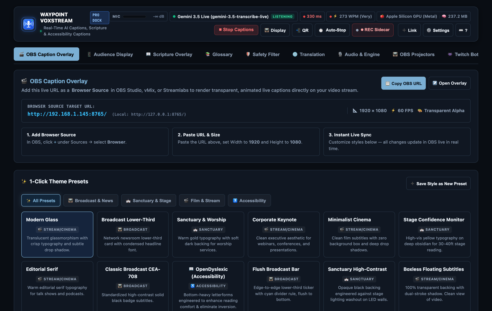
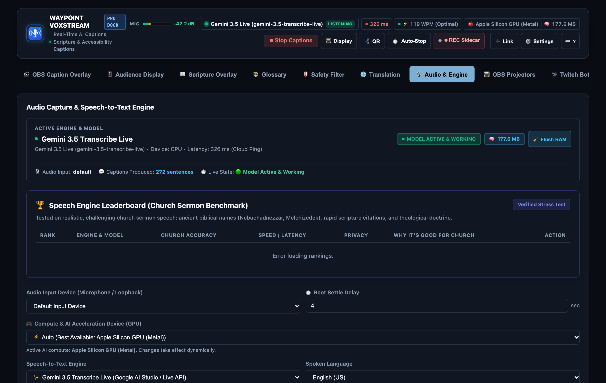
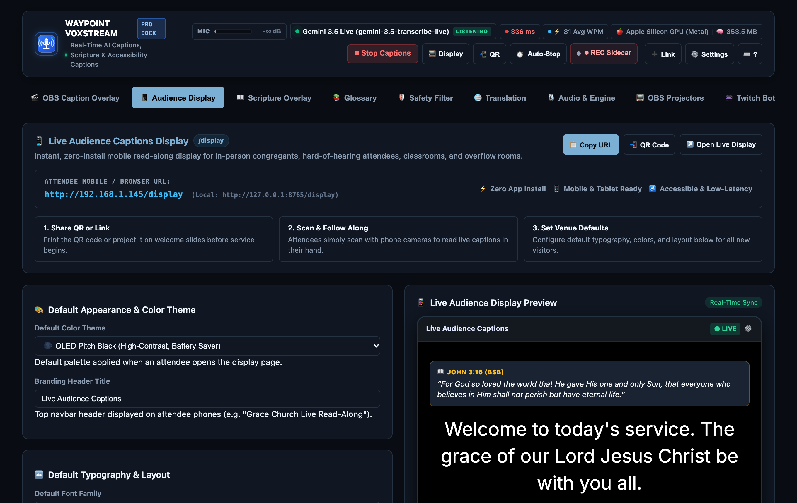
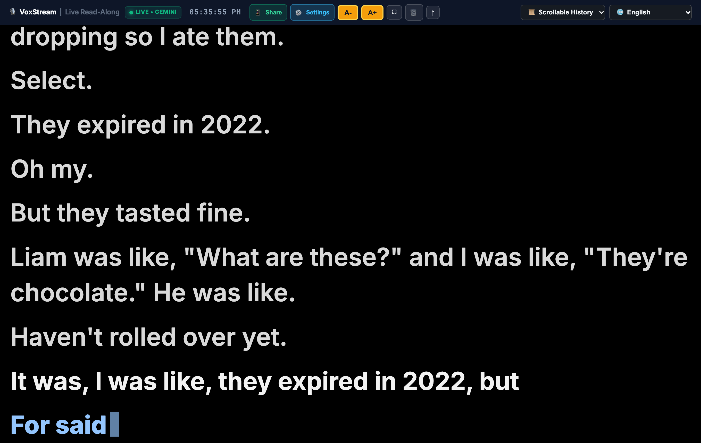
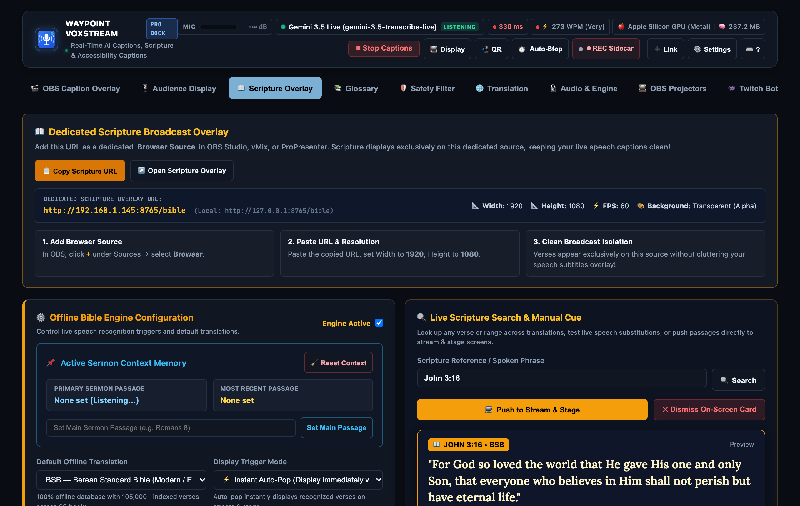

<div align="center">

# VoxStream

**Real-Time OBS Live Captioning, Multi-Language Translation & Church Broadcast Suite**

[](https://github.com/techguyowen/vox-stream/releases)
[](LICENSE)
[](https://www.python.org/)
[](https://obsproject.com/)
[](#quick-start--installation)
[](#2-live-read-along-display--stage-monitor-display)

[**Quick Start**](#quick-start--installation) • [**Core Features**](#core-features) • [**Speech Engines**](#1-multi-tier-speech-recognition-engines) • [**OBS Setup**](#obs-studio-integration--control) • [**API Reference**](#rest--websocket-api) • [**User Manual**](USER_MANUAL.md)

</div>

---

**VoxStream** is a low-latency, real-time speech-to-text captioning, multi-language translation, and scripture projection suite built for **OBS Studio**, churches, live events, and broadcast studios on **Windows, macOS, and Linux**.

It combines **10 hot-switchable speech recognition engines** (offline & cloud), a **zero-latency multi-user audience display (`/display`)** supporting 200+ concurrent Wi-Fi devices, an **offline Bible scripture engine (BSB, WEB, KJV)**, **ProPresenter & Faithlife Proclaim worship auto-mute**, and a **native Desktop Control Center & System Tray app**.

<p align="center">
  
</p>

---

## Table of Contents

- [Highlights at a Glance](#highlights-at-a-glance)
- [Quick Start & Installation](#quick-start--installation)
  - [Windows (1-Click Turnkey Installer)](#windows-1-click-turnkey-installer)
  - [macOS](#macos)
  - [Linux](#linux-ubuntu-debian-fedora-arch)
- [Web Interfaces & Local URLs](#web-interfaces--local-urls)
- [Core Features](#core-features)
  - [1. Multi-Tier Speech Recognition Engines](#1-multi-tier-speech-recognition-engines)
  - [2. Live Read-Along Display & Stage Monitor (`/display`)](#2-live-read-along-display--stage-monitor-display)
  - [3. Multi-Language Translation & Interpreter Mode](#3-multi-language-translation--interpreter-mode)
  - [4. Offline Bible Engine & Spoken Scripture Lookup](#4-offline-bible-engine--spoken-scripture-lookup)
  - [5. Worship Auto-Mute (ProPresenter, Faithlife Proclaim & Acoustic DSP)](#5-worship-auto-mute-propresenter-faithlife-proclaim--acoustic-dsp)
  - [6. Accessibility Suite (WCAG 2.2 AAA)](#6-accessibility-suite-wcag-22-aaa)
  - [7. Native Desktop Launcher, System Tray & OS Lifecycle](#7-native-desktop-launcher-system-tray--os-lifecycle)
  - [8. Post-Production: YouTube Chapters, AI Summaries & SRT/VTT](#8-post-production-youtube-chapters-ai-summaries--srtvtt)
- [OBS Studio Integration & Control](#obs-studio-integration--control)
- [Hardware & GPU Acceleration](#hardware--gpu-acceleration)
- [REST & WebSocket API](#rest--websocket-api)
- [Documentation & Guides](#documentation--guides)
- [Testing](#testing)
- [License](#license)

---

## Highlights at a Glance

| Capability | Details |
| :--- | :--- |
| **Speech Engines (10)** | Local Faster-Whisper, Gemini 3.5 Transcribe Live, Vosk, Sherpa-ONNX, NVIDIA Parakeet, SenseVoice, Moonshine, Google Cloud STT, Bandwidth Labs, Google Web Speech |
| **Automatic Offline Failover** | Instant failover to local offline STT (Vosk/Whisper) if venue internet drops, with automatic background recovery when cloud connectivity returns |
| **Multi-User Audience Display** | Supports **200+ simultaneous phones/tablets** on local Wi-Fi (`/display`) with `< 1 ms` English fast-path fan-out and delta transcript catch-up on reconnect |
| **Multi-Language & Interpreter** | 30+ simultaneous text translation languages (Google, Offline NLLB-200, Gemini) + optional Gemini Live bidirectional **In-Ear Audio Interpreter** |
| **Offline Bible Engine** | Sub-millisecond lookup across all 66 books in **BSB (ESV-style)**, **WEB (NIV-style)**, and **KJV**, with stateful chapter context tracking |
| **Worship Auto-Mute** | Syncs with **ProPresenter 7** and **Faithlife Proclaim** (plus real-time acoustic music detection and OBS scene triggers) to pause captions during singing |
| **Broadcast Outputs** | Transparent OBS Browser Overlay (`/`), Native **CEA-608/708** embedded stream captions (YouTube/Twitch `[CC]` button), Twitch Chat Bot, and synchronized `.srt`/`.vtt` sidecar recording |
| **24/7 Booth Reliability** | Windows `K32EmptyWorkingSet` RAM watchdog, graceful nightly shutdown hooks (`CTRL_SHUTDOWN_EVENT`), morning Startup auto-boot, and OS sleep/App Nap prevention |

---

## Quick Start & Installation

### Prerequisites
* **OBS Studio**: `28.0+` (`30.0+` recommended).
* **OS**: Windows 10/11 (x64), macOS 12+ (Apple Silicon & Intel), or Linux.
* **Windows**: Zero manual prerequisites—`setup_windows.bat` automatically installs Python 3.11, Git, and the Visual C++ Runtime if missing.

### Windows (1-Click Turnkey Installer)

```cmd
git clone https://github.com/techguyowen/vox-stream.git
cd vox-stream
setup_windows.bat
```

1. **Double-click `setup_windows.bat`**: Creates an isolated `.venv`, installs GPU acceleration (NVIDIA CUDA or AMD DirectML), pre-caches offline speech models, configures Windows Firewall & microphone privacy permissions, and creates **Desktop**, **Start Menu**, and **Windows Startup** shortcuts.
2. **Launch VoxStream**:
   * **Desktop Control Center**: Double-click the **VoxStream** icon on your Desktop (or `VoxStream.vbs` for a windowless console launch).
   * **Auto-Opens Dashboard**: Automatically opens `http://127.0.0.1:8765/dashboard` in your default browser on startup.

### macOS

```bash
git clone https://github.com/techguyowen/vox-stream.git
cd vox-stream
./setup_mac.sh
./run_captioner.sh
```

* Creates `.venv`, configures Apple Silicon (`mps`) / CoreAudio dependencies, and supports 1-click `~/Desktop/VoxStream.command` and `LaunchAgent` login auto-start from the Control Center.

### Linux (Ubuntu, Debian, Fedora, Arch)

```bash
# Install PortAudio & FFmpeg (Debian/Ubuntu example)
sudo apt update && sudo apt install -y python3-venv python3-pip libportaudio2 ffmpeg git

git clone https://github.com/techguyowen/vox-stream.git
cd vox-stream
./setup_linux.sh
./run_captioner.sh
```

<details>
<summary><strong>Manual Virtual Environment Setup & Full Package Manifest (Click to expand)</strong></summary>

```bash
# 1. Create and activate virtual environment
python3 -m venv .venv
source .venv/bin/activate        # macOS / Linux
# .venv\Scripts\activate.bat     # Windows CMD

# 2. Install dependencies
pip install --upgrade pip
pip install -r requirements.txt

# 3. Copy default configuration and run
cp config.json.example config.json
python -m obs_captioner.main
```

| Category | Packages / Components | Purpose |
| :--- | :--- | :--- |
| **Speech Recognition** | `faster-whisper`, `vosk`, `sherpa-onnx`, `useful-moonshine`, `google-genai`, `google-cloud-speech` | Offline & cloud streaming STT engines |
| **GPU & VAD** | `torch`, `onnxruntime`, `nvidia-cublas-cu12`, `nvidia-cudnn-cu12`, `torch-directml` | CUDA, DirectML, Apple MPS, and Silero VAD v5 |
| **Audio & Web** | `sounddevice`, `numpy`, `scipy`, `aiohttp`, `websockets`, `obsws-python`, `pystray`, `psutil` | Low-latency audio capture, WebSockets, OBS v5 RPC, and system tray |

</details>

---

## Web Interfaces & Local URLs

Once VoxStream is running, open any of the following interfaces on the host PC or from any phone/tablet on the same Wi-Fi network:

| Interface | Local Host URL | Wi-Fi / LAN URL | Purpose |
| :--- | :--- | :--- | :--- |
| **Pro Control Dashboard** | `http://127.0.0.1:8765/dashboard` | `http://<LAN_IP>:8765/dashboard` | Full configuration studio, telemetry, and In-OBS Custom Dock |
| **Audience & Stage Display** | `http://127.0.0.1:8765/display` | `http://<LAN_IP>:8765/display` | Mobile read-along PWA, multi-language viewer, and stage teleprompter |
| **Mobile Operator Remote** | `http://127.0.0.1:8765/operator` | `http://<LAN_IP>:8765/operator` | Simplified touch remote for volunteers (Start/Pause, Panic, Scripture Cue) |
| **OBS Stream Overlay** | `http://127.0.0.1:8765/` | `http://<LAN_IP>:8765/` | Transparent lower-third caption & scripture overlay for OBS Browser Source |
| **Scripture Overlay Only** | `http://127.0.0.1:8765/bible` | `http://<LAN_IP>:8765/bible` | Dedicated Bible verse broadcast overlay |

> **Tip:** Click **Share / QR Code** in the Dashboard header (or click **`📋 Copy Link`** in the Desktop Launcher) to let congregants scan and open `/display` on their phones in seconds.

---

## Core Features

### 1. Multi-Tier Speech Recognition Engines

Switch engines live from the dashboard without restarting OBS or dropping connected viewers:

| Engine | Mode | Latency | Best For |
| :--- | :--- | :--- | :--- |
| **Gemini 3.5 Transcribe Live** | Cloud WebSocket | `~180 ms` | Highest accuracy (`98.4%`), smart disfluency cleanup, custom church vocabulary prompting |
| **Local Faster-Whisper** | 100% Offline (CUDA / CPU) | `~450 ms` | **#1 Offline Champion (`91.7%`)**—recognizes complex biblical names (*Melchizedek, Nebuchadnezzar*) with zero cloud keys |
| **Local Vosk / Kaldi** | 100% Offline (CPU) | `~30 ms` | Instant syllable-by-syllable confidence monitor feedback & ultra-lightweight emergency fallback |
| **Sherpa-ONNX / Parakeet / SenseVoice** | 100% Offline (ONNX) | `~80–150 ms` | Fast streaming transducer models with acoustic event detection (applause/music) |
| **Local Moonshine** | 100% Offline (ONNX/Torch) | `~120 ms` | Lightweight edge neural transformer for low-power CPUs |
| **Google Cloud STT / Bandwidth / Web Speech** | Cloud Streaming | `~150–300 ms` | Enterprise gRPC/WebSocket alternatives |

<p align="center">
  
</p>

---

### 2. Live Read-Along Display & Stage Monitor (`/display`)

Designed for congregants reading on personal phones, Deaf/Hard-of-Hearing accessibility, and stage confidence monitors:

* **Two Viewing Modes**:
  * **Scrollable History (Default)**: Full bi-directional transcript of the service with automatic reconnect catch-up (`/api/history?since=`) if a viewer's phone briefly loses Wi-Fi.
  * **Live Prompter (Auto-Fade)**: Displays only the active 2–3 lines for clean stage teleprompting.
* **Touch & Mobile Polish**:
  * **Two-Finger Pinch-to-Resize**: Pinch directly on the transcript to scale font size smoothly (`16px`–`120px`).
  * **Dual-Strategy Screen Wake Lock**: Combines the native `navigator.wakeLock` API with a silent media fallback so iPads and Android phones never dim over HTTP LAN connections.
  * **Installable PWA**: Add to Home Screen on iOS/Android for a full-screen standalone app experience.

<p align="center">
  
</p>

<p align="center">
  
</p>

---

### 3. Multi-Language Translation & Interpreter Mode

* **Simultaneous Multi-Language Routing (30+ Languages)**:
  * Every viewer on `/display` independently selects their own language (*Spanish, French, Chinese, Korean, Portuguese, Vietnamese, Arabic, Ukrainian, Russian, German, Tagalog*, etc.).
  * **Zero-Latency English Fast-Path**: English viewers receive captions in `< 1 ms` without waiting on translation tasks.
  * **Deduplicated Parallel Fan-Out**: Server translates each active language once per sentence (`O(languages)` instead of `O(clients)`), backed by a persistent 2-tier L1/L2 disk cache (`translation_cache.json`).
* **Translation Providers**:
  * **Google Translate** (Free zero-setup default)
  * **Offline NLLB-200** (`facebook/nllb-200-distilled-600M` via CTranslate2 — 100% offline local translation)
  * **Gemini 3.8 Flash** (Context-aware theological translation)
* **Gemini Live Interpreter Mode (Off by Default)**:
  * Optional bidirectional audio sidecar (`gemini-3.5-live-translate-preview`) that streams synthesized 24 kHz translated speech audio directly to headphones on `/display` clients tuned to the target language.

---

### 4. Offline Bible Engine & Spoken Scripture Lookup

* **Spoken Citation Recognition**: Automatically formats and looks up spoken references across all 66 books (*"John chapter 3 verse 16"* $\rightarrow$ **`John 3:16`**, *"First Corinthians 13 4 through 7"* $\rightarrow$ **`1 Corinthians 13:4-7`**).
* **Stateful Sermon Context Tracking**: When a pastor establishes a main text (e.g., *"Turn to Romans chapter 8"*) and later says *"look down at verse 28"*, VoxStream resolves **`Romans 8:28`** automatically.
* **3 Bundled Offline Translations (`< 0.1 ms` SQLite lookup)**:
  * **BSB (Berean Standard Bible)** — Modern ESV-equivalent phrasing.
  * **WEB (World English Bible)** — Clean modern English.
  * **KJV (King James Version)** — Classic traditional text.
* **Independent Routing**: Toggle scripture cards independently on the **OBS Stream Overlay** vs. the **Audience/Stage Display** (`?bible=0` URL override supported).

<p align="center">
  
</p>

---

### 5. Worship Auto-Mute (ProPresenter, Faithlife Proclaim & Acoustic DSP)

Prevent song lyrics or worship music from cluttering sermon captions using three layered automation systems:

1. **ProPresenter 7 & Faithlife Proclaim Sync**: Connects to ProPresenter's Network API or Proclaim's local webhook/status bridge to detect worship song slides (`[Chorus]`, `[Verse]`, musical symbols, hymn labels) and automatically pauses captioning during songs—while keeping scripture slides unmuted.
2. **OBS Scene Auto-Mute**: Automatically pauses captioning when switching to *Worship / Prelude / Video* scenes in OBS and resumes on *Sermon / Podium* scenes.
3. **Real-Time Acoustic Music Detector**: Built-in spectral flatness, harmonic continuity, and ZCR analyzer suppresses instrumental music and singing in `< 0.2 ms` per audio frame.

---

### 6. Accessibility Suite (WCAG 2.2 AAA)

* **Bionic Reading**: Highlights initial word fixation letters on finalized sentences (zero interim layout jitter) to assist viewers with ADHD and dyslexia.
* **OpenDyslexic & Lexend Fonts**: Built-in readability typography alongside expanded letter-tracking (`Visual Aid Mode`).
* **Custom Theme Editor & High-Contrast Presets**: *OLED Black, Black-on-White, High-Vis Yellow on Black, Stage Amber, Slate Blue*, plus a live color picker in `/display`.
* **Paced Reading (`Slow Down Text`)**: Buffers rapid speech bursts to a steady ~135 WPM reading cadence.
* **Speaking Pace (WPM) Telemetry**: Real-time 45-second sliding WPM gauge on the dashboard with speaker pace indicators.

---

### 7. Native Desktop Launcher, System Tray & OS Lifecycle

Built for unattended 24/7 or nightly-shutdown church booth computers on Windows and macOS:

* **Standalone Control Center (`obs_captioner/launcher.py`)**:
  * **Windows 10/11 Immersive Dark Title Bar** (`DwmSetWindowAttribute`) and native platform font stacks (`Segoe UI`/`Consolas` on Windows, `Helvetica Neue`/`Menlo` on macOS).
  * **Single-Instance Guard**: Double-clicking the desktop shortcut while VoxStream is already running automatically restores and focuses the existing Control Center window.
  * **1-Click LAN Display Copy**: Shows your machine's real Wi-Fi URL (`http://<LAN_IP>:8765/display`) with a **`📋 Copy Link`** button.
* **Dynamic System Tray Status Badge**:
  * Displays a live colored indicator dot on the Windows Taskbar Tray / macOS Menu Bar icon (**Green** = Live, **Amber** = Paused, **Red** = Error, **Slate** = Stopped) and sends native OS toast notifications on failover.
* **Nightly Shutdown & Morning Auto-Boot Ready**:
  * **Graceful Shutdown Hook**: Intercepts Windows `CTRL_SHUTDOWN_EVENT` / `CTRL_LOGOFF_EVENT` (`SetConsoleCtrlHandler`) and POSIX signals to flush `.srt`/`.vtt` subtitle files and atomically save `translation_cache.json` before the PC powers off.
  * **Run at Startup Toggle**: 1-click checkbox configures Windows Startup (`shell:startup`) or macOS `LaunchAgent` (`~/Library/LaunchAgents/com.voxstream.captioner.plist`) so VoxStream boots automatically every morning.
  * **Host OS Keep-Awake**: Calls Windows `SetThreadExecutionState` and macOS `caffeinate` while actively captioning so the booth PC never enters sleep or App Nap mid-sermon, then releases the lock when paused/stopped so nightly shutdowns proceed normally.
  * **Windows RAM Watchdog**: Automatically trims inactive C++/ONNX/PyTorch allocator pages via `K32EmptyWorkingSet` every 10 minutes (and on engine switches).

---

### 8. Post-Production: YouTube Chapters, AI Summaries & SRT/VTT

* **Synchronized OBS Recording Sidecars**: Automatically writes time-aligned `.srt` and `.vtt` files alongside your OBS video recordings (`auto_record_subtitles`), flushing every line to disk in real time.
* **Automated YouTube Chapters**: Generates timestamped chapter markers from detected scripture readings, prayers, and sermon transitions.
* **AI Sermon Notes & Study Guide Generator**: 1-click post-sermon summary (key takeaways, scripture list, memorable quotes, and small-group discussion questions) powered by Gemini 3.8 Flash, local Ollama (`llama3.2`), or offline heuristics.

---

## OBS Studio Integration & Control

### Setup in OBS
1. **In-OBS Control Dock**:
   * In OBS, open **Docks → Custom Browser Docks...** $\rightarrow$ Name: `VoxStream` | URL: `http://127.0.0.1:8765/dashboard`
2. **Transparent Stream Overlay**:
   * Add a **Browser Source** to your scene $\rightarrow$ URL: `http://127.0.0.1:8765/` (`1920x1080`).
3. **Enable OBS WebSocket v5**:
   * In OBS, open **Tools → WebSocket Server Settings** and enable the server (default port `4455`).

### Built-In OBS Control & Automation
* **WebSocket Connection Manager**: Live connection telemetry, host/port/password configuration, and 1-click reconnect directly from the Dashboard.
* **Stream & Recording Lifecycle Sync**: Automatically starts captioning when OBS starts streaming or recording (`auto_start_on_stream` / `auto_start_on_record`) and optionally auto-stops when the stream/recording ends (`auto_stop_on_stream` / `auto_stop_on_record`) to prevent cloud token usage after service.
* **Scene-Based Auto-Mute**: Configure muted vs. active OBS scenes so switching to *Worship / Prelude / Video* scenes automatically pauses captioning, and switching to *Sermon / Podium* resumes it.
* **Remote Projector Control & 24/7 Monitor Keeper**:
  * Trigger Fullscreen Projectors (*Preview, Program, Multiview, or specific Source*) onto any physical monitor index directly from the Dashboard.
  * **Persistent Projector Watchdog (`projector_persistent_lock`)**: Periodically verifies and re-opens your stage/sanctuary projector monitor 24/7 or within a custom weekly schedule window (e.g., Sundays `07:00–14:00`) if a TV or OBS restarts.
* **Dual Native OBS Outputs**: Simultaneously updates any native OBS GDI+/FreeType2 Text Source (`Live Captions`) and injects **CEA-608/708** closed caption packets into your H.264/HEVC stream for the YouTube Live and Twitch `[CC]` button.

---

## Hardware & GPU Acceleration

VoxStream automatically detects and prioritizes your best discrete GPU (`preferred_gpu: "auto"`):

* **NVIDIA GPUs (CUDA)**: Auto-discovers `.venv` CUDA 12 / cuDNN 9 DLLs (`os.add_dll_directory`) for `< 150 ms` `faster-whisper` and ONNX inference.
* **AMD Radeon GPUs (DirectML)**: Accelerates inference on DirectX 12 GPUs (e.g., Radeon RX 580, Vega, RDNA) via `torch-directml` and `onnxruntime-directml`.
* **Apple Silicon (M1–M4)**: Uses Metal Performance Shaders (MPS) and Accelerate frameworks.
* **Multi-Core CPU**: Optimized `int8` quantization works out of the box on any modern laptop or mini-PC.

---

## REST & WebSocket API

Full automation support for **Elgato Stream Deck**, **Bitfocus Companion**, **ProPresenter**, and custom scripts. Use `X-API-Key` (admin) or `X-Operator-Pin` (volunteer remote) when authentication is enabled.

<details>
<summary><strong>Core HTTP & WebSocket Endpoints (Click to expand)</strong></summary>

| Method | Endpoint | Description |
| :--- | :--- | :--- |
| `GET` | `/api/status` | System status, active engine, RAM/GPU telemetry, WPM, and LAN URLs |
| `GET` / `POST` | `/api/config` | Read or hot-update live configuration |
| `POST` | `/api/control/start` / `stop` / `toggle` | Start, pause, or toggle live captioning |
| `POST` | `/api/control/panic` | Emergency Panic: immediately clears captions across all screens |
| `POST` | `/api/system/trim_memory` | Triggers immediate garbage collection & OS working set RAM purge |
| `POST` | `/api/presentation/slide` | Webhook receiver for ProPresenter / Faithlife Proclaim slide updates |
| `GET` | `/api/history?since=<ts>` | Delta transcript history for client reconnect catch-up |
| `GET` | `/api/transcript/chapters` | Auto-generated YouTube timestamps & scripture markers |
| `GET` | `/api/transcript/export?format=srt\|vtt\|txt` | Download session subtitles |
| `WS` | `/ws?lang=<code>&role=display` | Real-time caption & translated audio WebSocket stream |
| `WS` | `/api/control/ws` | Real-time dashboard telemetry, VU meter, and control events |

</details>

---

## Documentation & Guides

* [**User Manual & Quick Start Guide (`USER_MANUAL.md`)**](USER_MANUAL.md) — Volunteer-friendly guide, QR sharing, and troubleshooting.
* [**Installation Guide (`INSTALL_GUIDE.md`)**](INSTALL_GUIDE.md) — Detailed OS, audio routing, and GPU setup instructions.
* [**Full Setup Guide (`FULL_SETUP_GUIDE.md`)**](FULL_SETUP_GUIDE.md) — End-to-end production booth walkthrough.
* [**REST & WebSocket API Guide (`API_GUIDE.md`)**](API_GUIDE.md) — Complete endpoint schemas and webhook payloads.
* [**Stream Deck & Bitfocus Companion (`integrations/streamdeck_companion.md`)**](integrations/streamdeck_companion.md) — Hardware button setup.
* [**System Specification (`FEATURES_AND_SYSTEM_SPECIFICATION.md`)**](FEATURES_AND_SYSTEM_SPECIFICATION.md) — Architectural deep dive.

---

## Testing

Run the automated test suites (850+ unit, integration, concurrency, and OS lifecycle tests):

```bash
# Run core unittest suite (373+ tests)
python test_captioner.py

# Run full pytest suite including multi-user scaling, translation, and Windows/macOS UX (480+ tests)
pytest -q
```

---

## License

Released under the [GNU Affero General Public License v3.0 (AGPLv3)](LICENSE).

